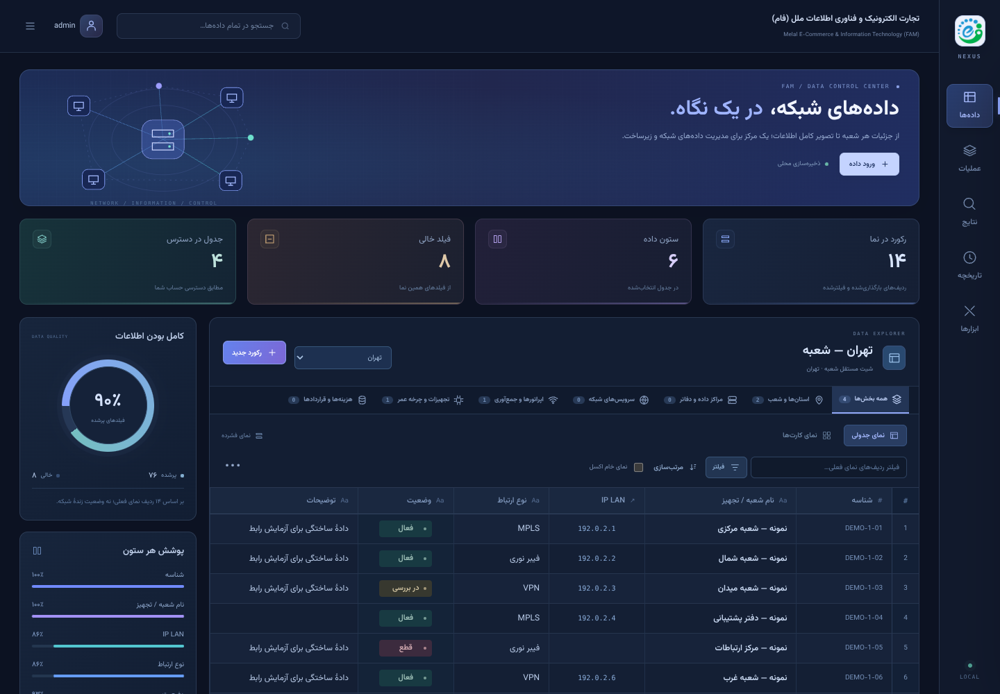

# FAM Nexus — مرکز مدیریت داده

این نسخه پس از رد شدن طرح‌های روشن و مینیمال قبلی ساخته شده است. تغییر فقط رنگ نیست: صفحهٔ اصلی اکنون یک مرکز مدیریت چندبخشی شامل سربرگ تصویری، خلاصه‌های عددی، نمودارهای محاسبه‌شده، جدول داده و کتابخانهٔ بخش‌ها است.



## مشاهده و دریافت

- [پیش‌نمایش زنده](https://3003-is83dxd1net7gv8lrdfyd.e2b.app/FAM-Nexus.html) — وابسته به روشن بودن محیط جلسه
- [HTML در GitHub](https://github.com/mohsenmehri/divergenc/blob/arena/a50077cc-divergenc/FAM-Nexus.html)
- [دانلود فایل مستقل](https://github.com/mohsenmehri/divergenc/raw/refs/heads/arena/a50077cc-divergenc/FAM-Nexus.html)

نسخه‌های اصلی، Operations، Studio، Grid و Workspace دست‌نخورده‌اند. Nexus خروجی مستقل دیگری است؛ موتور workbook، مجوزها، درج/حذف، ذخیره و ویرایش محافظت‌شدهٔ رکورد از Grid استفاده می‌شوند. CSS/JS خارجی برای اجرا لازم نیست.

## طراحی جدید

- **فضای سرمه‌ای تیره با آبی، بنفش و فیروزه‌ای:** سربرگ با تصویر برداری شبکه، کارت‌های آماری رنگی، تایپوگرافی فارسی تعبیه‌شده و سطوح چندلایه.
- **ناوبری باریک ثابت:** مسیرهای داده، عملیات، نتایج، تاریخچه و ابزارها؛ در موبایل به نوار پایین صفحه تبدیل می‌شود.
- **مرکز داده و تحلیل کنار هم:** جدول یا کارت‌ها در بخش اصلی؛ نمودار تکمیل اطلاعات، پوشش ستون‌ها و انتخاب بخش در ستون کناری.
- **انتخاب مستقیم جدول:** انتخاب‌گر کنار عنوان جدول، بدون نیاز به اسکرول به کتابخانهٔ بخش‌ها.
- **نمای فشرده/راحت:** تغییر فاصلهٔ ردیف‌ها با حفظ تنظیم در همین مرورگر؛ هیچ تغییری در workbook نمی‌دهد.
- **فرم‌های هماهنگ:** پنل جزئیات رکورد، ورود، عملیات، حساب‌ها، درج و پیام‌ها با همان طیف رنگ بازطراحی شده‌اند.
- **جستجوی سراسری:** کلید `/` بیرون از ورودی‌ها و پنجره‌های ویرایش؛ در موبایل دکمهٔ جستجو، کادر قابل بستن را باز می‌کند.

طرح شبکهٔ بالای صفحه **تزئینی** است و توپولوژی واقعی یا اتصال زندهٔ تجهیزات را نمایش نمی‌دهد. نشان محلی هم به معنای ذخیره‌سازی مرورگر است، نه پایش یا سلامت شبکه.

## نمودارها واقعاً چه چیزی را حساب می‌کنند؟

خلاصه‌ها از workbook و ردیف‌های جدول فعلی خوانده می‌شوند؛ مقدار تصادفی، روند زمانی ساختگی، uptime یا آمار آنلاین تولید نمی‌شود.

- **رکورد در نما:** ردیف‌های غیرخالیِ بارگذاری‌شده که فیلتر فعلی آن‌ها را پنهان نکرده است؛ ردیف عنوان شمارش نمی‌شود.
- **ستون داده:** تعداد ستون‌های عنوان/ردیف‌های همان نما، با سقف ستون‌های مجاز موتور.
- **فیلد خالی:** سلول خالی یا فقط فاصله در همین ردیف‌ها؛ عدد `0` و مقدار `false` خالی محسوب نمی‌شوند.
- **جدول در دسترس:** شیت‌های داده‌ای مجاز برای حساب فعلی؛ شامل شیت‌هایی است که موتور آن‌ها را شیت داده تشخیص می‌دهد، نه صرفاً استان‌ها.
- **کامل بودن اطلاعات:** درصد فیلدهای پرشده؛ این معیار درستی محتوا یا سلامت تجهیزات را ارزیابی نمی‌کند.
- **پوشش هر ستون:** سهم فیلدهای پرشده در پنج ستون اول، با عنوان واقعی همان ستون‌ها.

فیلتر، بارگذاری بیشتر، تغییر بخش و ویرایش سلول خلاصه‌ها را به‌روزرسانی می‌کند. محاسبه فقط‌خواندنی است و workbook، ترتیب ردیف‌ها یا Undo را تغییر نمی‌دهد. برای شیت‌های دارای merge، درصد و آمار فیلدهای خالی/پر غیرفعال می‌شوند تا برداشت نادرست از سلول‌های ادغام‌شده ایجاد نشود. کاربر سطح ۴ همان نمای مجازِ جداگانهٔ موتور را می‌بیند؛ خلاصه‌های Nexus برای او محاسبه نمی‌شوند.

## نمونه و داده‌های موجود

در محیط خالی، دکمهٔ **«دیدن دادهٔ نمونه»** در سربرگ و صفحهٔ شروع در دسترس حساب مجاز است. ۴۲ رکورد صریحاً ساختگی برای تهران، فارس و تجهیزات نمونه و شیت آرشیو لازم ساخته می‌شود؛ IPها از `192.0.2.0/24` هستند.

چند فیلد نمونه عمداً خالی است تا نمودارها قابل آزمایش باشند: جدول تهران ۱۴ ردیف و ۶ ستون دارد؛ ۷۶ فیلد پر از ۸۴، ۸ فیلد خالی و پوشش گرد‌شدهٔ ۹۰٪. وارد کردن نمونه خودکار نیست و با وجود هر شیت داده رد می‌شود، حتی در فراخوانی مستقیم.

این فایل و رابط‌های قبلی روی پورت ۳۰۰۳ مبدأ مشترک دارند؛ حساب‌ها و دادهٔ مرورگرشان مشترک است. نمونهٔ جدید دادهٔ موجود را اصلاح یا جایگزین نمی‌کند. برای آزمایش مستقل از مبدأ جداگانه استفاده کنید و از دادهٔ واقعی پشتیبان بگیرید.

## ساخت و آزمون

```sh
python scripts/build_nexus_ui.py
node --check src/nexus-ui.js
# با سرو فایل Nexus روی پورت 3003:
node scripts/smoke_nexus.cjs
```

ورودی ساخت `FAM-Grid.html` است. بعد از تغییر موتور مشترک، ابتدا Grid و سپس Nexus را بسازید. `FAM_URL` و `CHROMIUM_PATH` برای آزمون آدرس یا مرورگر دیگر قابل تنظیم‌اند.

### نتیجهٔ آزمون این نسخه

Linux / Chromium **138.0.7204.0**:

- **۳۵/۳۵ آزمون هدفمند موفق:** ۳۴ آزمون حساب‌ها، چهار سطح مجوز، عملیات استانی، حفاظت ویرایش، ماندگاری و صفحه‌بندی Grid؛ به‌علاوهٔ آزمون خلاصه‌های Nexus.
- آزمون جدید: شمارش درست صفر و false، فیلتر و حالت بدون نتیجه، عدم تغییر workbook، غیرفعال شدن درصد برای merge و عدم محاسبه برای نقش ۴.
- آزمون عملی مستقل: نمونهٔ محافظت‌شده، اعداد واقعی ۷۶/۸/۸۴ و ۹۰٪، انتخاب‌گر جدول، تراکم پایدار، جدول/کارت، ویرایش صحیح بعد از مرتب‌سازی، نمای خام، درج، حذف، Undo، خروجی XLSX و حفظ ویرایش و پیش‌نویس پس از reload.
- عرض‌های ۱۴۴۰، ۸۰۰، ۳۹۰ و ۳۲۰؛ بدون سرریز افقی صفحه، با اسکرول مستقل جدول. حساب و جستجو در موبایل در دسترس‌اند؛ تمام فیلدهای کارت داخل کارت جا می‌گیرند.
- خطای uncaught، ID تکراری یا CSS/JS خارجی در اجرای عملی ثبت نشد.

تصاویر و لاگ‌های آزمون در `test-results/nexus-*` و `.cache/nexus-*` تولید می‌شوند و وارد Git نمی‌شوند؛ فقط تصویر نهایی این راهنما نگهداری می‌شود.

**حدود ادعا:** اجرای واقعی Windows/IIS، Chromium 122 یا همزمانی چند کاربر انجام نشده است. این تغییر بک‌اند، اشتراک دادهٔ سروری یا پایش روتر اضافه نمی‌کند. فیلتر، مرتب‌سازی و نمودارها روی ردیف‌های بارگذاری‌شده‌اند؛ برای دادهٔ بیشتر از کنترل صفحه‌بندی استفاده کنید. مجوزهای مرورگری حفاظت ضد DevTools نیستند. سایر محدودیت‌های موتور در [راهنمای Grid](GRID_UI_FA.md) آمده است.
