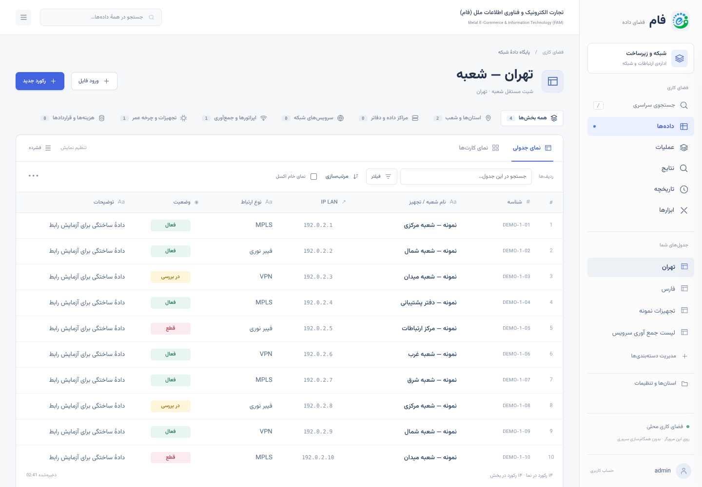

# FAM Workspace — بازطراحی فضای کاری

نسخهٔ مستقل جدید پس از رد شدن ظاهر Grid توسط کاربر؛ هدف یک رابط خلوت و خوانا با الگوی نرم‌افزارهای دادهٔ مدرن است، نه ادعای امکانات کامل یا اتصال به Airtable.



## دریافت و اجرا

- [پیش‌نمایش زنده](https://3003-is83dxd1net7gv8lrdfyd.e2b.app/FAM-Workspace.html) — وابسته به روشن بودن محیط جلسه
- [فایل در GitHub](https://github.com/mohsenmehri/divergenc/blob/arena/a50077cc-divergenc/FAM-Workspace.html)
- [دانلود HTML مستقل](https://github.com/mohsenmehri/divergenc/raw/refs/heads/arena/a50077cc-divergenc/FAM-Workspace.html)

فایل‌های اصلی، Operations، Studio و Grid تغییر نکرده‌اند. موتور workbook، حساب‌های محلی و ویرایش امن رکورد از نسخهٔ Grid استفاده می‌شوند. فایل Workspace مستقل است و برای اجرا به CSS/JS خارجی نیاز ندارد.

## تفاوت واقعی چیدمان

- **ناوبری ثابت در سمت راست:** هویت سازمان، مسیرهای اصلی، جدول‌های داده و حساب کاربری در یک ستون؛ بخش جدول‌ها جداگانه اسکرول می‌شود.
- **عنوان و عملیات روشن:** مسیر صفحه، نام بخش، ورود فایل و «رکورد جدید» بیرون از جدول قرار دارند. نوار بزرگ بنفش نسخهٔ قبلی حذف شده است.
- **ناحیهٔ دادهٔ مستقل:** دسته‌ها بالای جدول، تب‌های جدول/کارت در بالای ناحیهٔ داده، فیلتر و مرتب‌سازی در ردیف ابزارهای همان جدول.
- **خوانایی:** فاصلهٔ منظم، قلم فارسی تعبیه‌شده، رنگ متن تیره‌تر، شناسه و IP متمایز، وضعیت‌های رنگی با گوشه‌های گرد. رنگ وضعیت از متن سلول می‌آید و نشانهٔ پایش زنده نیست.
- **نمای کارت:** کارت‌هایی با عنوان، شناسه و اطلاعات واقعی رکورد؛ همهٔ فیلدهای کارت در ارتفاع آن جا می‌گیرند و فهرست کارت‌ها اسکرول می‌شود.
- **پنل جزئیات:** ویرایش در پنل کناری با ذخیرهٔ صریح؛ بررسی مجوز، قفل، دادهٔ قدیمی و تراکنش/بازگردانی قبلی حفظ شده است.
- **تراکم نمایش:** دکمهٔ «فشرده / راحت» فاصلهٔ ردیف‌ها را تغییر می‌دهد. تنظیم در همان مرورگر می‌ماند و workbook را تغییر نمی‌دهد.
- **جستجو:** کلید `/` بیرون از ورودی‌ها و پنجره‌های ویرایش، جستجوی سراسری را فعال می‌کند. در عرض کم، جستجو در یک کادر بازشونده در دسترس است؛ دکمهٔ بستن و Escape دارد.
- **موبایل:** دکمهٔ بخش‌ها، ناوبری را باز و بسته می‌کند. انتخاب بخش یا صفحه آن را خودکار نمی‌بندد. حساب کاربری در سربرگ موبایل در دسترس می‌ماند و ابزارهای پیشرفته داخل منوی بخش‌ها قرار دارند.

## شروع بدون فایل

در محیط خالی، کاربر دارای مجوز می‌تواند «دیدن دادهٔ نمونه» را انتخاب کند. همان نمونهٔ ساختگی ۴۲ رکوردی Grid، با IPهای مستندسازی و بدون جایگزینی دادهٔ موجود، استفاده می‌شود. تصویر این راهنما همین نمونه است؛ دادهٔ واقعی سازمان نیست.

پیش‌نمایش Workspace و Grid روی پورت ۳۰۰۳ **مبدأ مشترک** دارند و بنابراین داده‌ها و حساب‌های محلی مشترک‌اند. تغییر نام فایل، دیتابیس مرورگر را جدا نمی‌کند. قبل از آزمایش روی دادهٔ واقعی پشتیبان بگیرید.

## ساخت و آزمون

```sh
python scripts/build_workspace_ui.py
node --check src/workspace-ui.js
# سرور باید FAM-Workspace.html را روی پورت 3003 سرو کند:
node scripts/smoke_workspace.cjs
```

ورودی ساخت، `FAM-Grid.html` است؛ ساخت Workspace فایل‌های قبلی را بازنویسی نمی‌کند. اگر موتور مشترک را تغییر دادید، ابتدا Grid و سپس Workspace را دوباره بسازید. برای مرورگر یا آدرس دیگر، متغیرهای `CHROMIUM_PATH` و `FAM_URL` قابل استفاده‌اند.

### نتایج این تغییر

در Linux / Chromium **138.0.7204.0**:

- **۳۴/۳۴ آزمون هدفمند** حساب‌ها، مجوزهای چهار سطح، رفتار درج/حذف/لغو و مسیریابی استانی، پنل رکورد و صفحه‌بندی کارت‌ها موفق بود.
- آزمون عملی مستقل در عرض‌های ۱۴۴۰، ۸۰۰، ۳۹۰ و ۳۲۰ بدون سرریز افقی صفحه موفق بود؛ خود جدول بزرگ اسکرول افقی دارد.
- ویرایش، مرتب‌سازی بدون تغییر ترتیب workbook، فیلتر دو نما، نمای خام، درج، حذف، Undo، خروجی XLSX و حفظ داده/پیش‌نویس پس از reload بررسی شدند.
- تراکم ردیف‌ها و ماندگاری تنظیم بدون تغییر workbook، میانبر جستجو، جستجو و حساب کاربری موبایل، حفظ وضعیت منو بعد از تغییر بخش، و جا شدن تمام فیلدهای کارت بررسی شدند.
- خطای uncaught، ID تکراری یا وابستگی CSS/JS خارجی در آزمون عملی ثبت نشد.

در بررسی اولیه، فیلدهای کارت به علت کوچک شدن ردیف‌های CSS Grid بریده می‌شدند؛ ارتفاع محتوایی صریح اصلاح و به آزمون اضافه شد. آزمون اولیهٔ حساب در عرض کم نیز نشان داد حساب نباید فقط در منوی بسته باشد؛ کنترل واقعی حساب اکنون در موبایل به سربرگ منتقل می‌شود و اجرای نهایی موفق بود.

لاگ‌ها در `.cache/workspace-*` و تصاویر/گزارش اجرای آزمون در `test-results/workspace-*` تولید می‌شوند و وارد Git نمی‌شوند. فقط تصویر نهایی راهنما نگهداری می‌شود.

**محدودیت‌ها:** این اجرا تست Windows/IIS یا Chromium 122 یا همزمانی چند کاربر نیست. حساب و داده همچنان محلی‌اند؛ بک‌اند یا همکاری سروری اضافه نشده است. فیلتر و مرتب‌سازی Grid روی ردیف‌های بارگذاری‌شده عمل می‌کنند؛ برای ادامهٔ داده از «نمایش رکوردهای بیشتر» استفاده کنید. مجوزهای مرورگری محافظت واقعی در برابر دست‌کاری سورس/DevTools نیستند. جزئیات موتور و محدودیت‌های ادغام سلول در [راهنمای Grid](GRID_UI_FA.md) آمده است.
